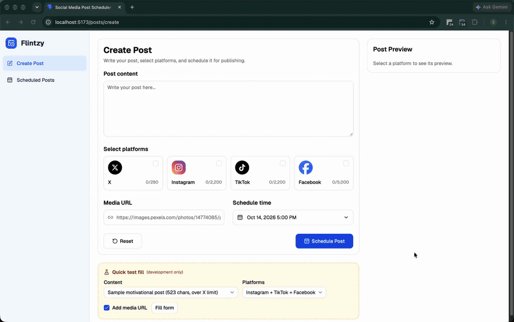
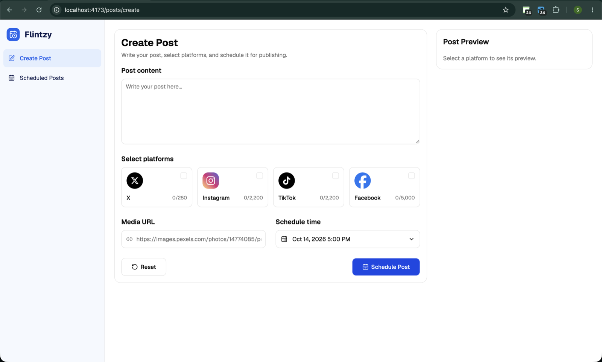
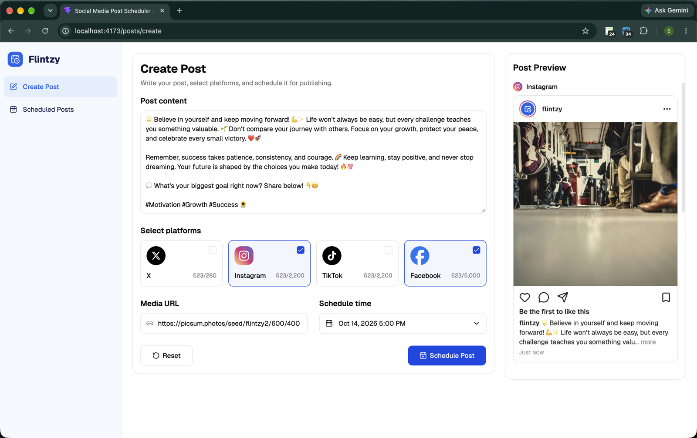
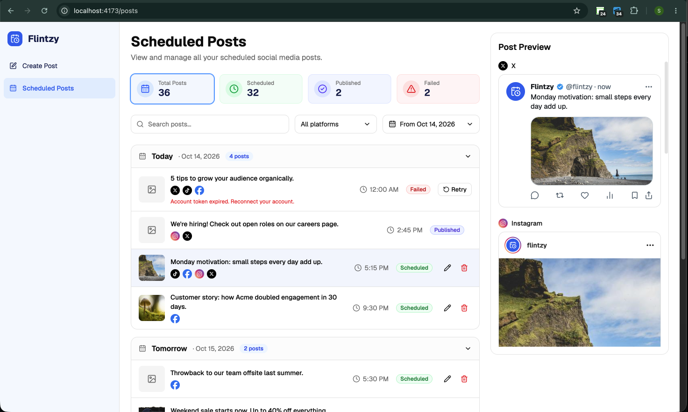

# Flintzy — Social Media Post Scheduler

A frontend for composing, scheduling and managing social media posts across **X, Instagram, TikTok and Facebook** from a single dashboard.

This is a frontend-only project: there are no real social integrations and no authentication. The API is mocked in the browser with [MSW](https://mswjs.io), so the app needs no backend, no second terminal, and works offline.

> Built for the "Social Media Post Scheduler" frontend assignment. The original brief is in [docs/REQUIREMENTS.md](docs/REQUIREMENTS.md).

## Features

**Post queue** (`/posts`)

- Posts grouped by day (Yesterday, Today, Tomorrow, then dates), collapsible, with infinite scroll
- Each post shows its content preview, platform icons, local-time schedule and status
- Search, multi-select platform filter, date range filter (defaults to "from today") and clickable status cards
- Every filter is kept in the URL, so filters survive a refresh and can be shared
- Retry failed posts with an optimistic update, a simulated 1s call that fails 20% of the time, and rollback on failure
- Loading skeletons, empty states and an error state with a retry button

**Composer** (`/posts/create`, `/posts/:id/edit`)

- Content, multiple platforms, optional image URL and a date/time picker
- Live character counter per selected platform (X 280, Instagram/TikTok 2,200, Facebook 5,000); scheduling is blocked if any selected platform's limit is exceeded
- Validation with React Hook Form and Zod, including "scheduled time must be in the future"
- Live, platform-style previews for each selected platform (desktop side panel, mobile bottom sheet)
- Edit screen prefilled from the post; published and past posts are locked

**Time zones**: times are stored in UTC and always shown in the user's local time zone.

**Responsive**: the sidebar becomes a drawer, filters stack and previews move into a sheet on small screens.

## Screenshots and demo

A walkthrough of creating a post, filtering the queue and retrying a failed post (about 90 seconds). It was recorded in development mode, so the orange "Quick test fill" panel is the dev-only helper described below.



Prefer a sharper version? Download the [full-quality video](docs/recordings/demo.mp4).

**Create post**: the empty composer.



**Create post with content**: live character counts per platform and platform-style previews.



**Post queue**: status cards, filters, posts grouped by day and the live preview of the selected post.



## Design

The UI was designed with the help of ChatGPT-generated mockups, kept in [designs/](designs/) ([create post](designs/create-post-screen.png), [post list](designs/post-list-screen.png)). They were rough initial designs and served as the starting reference. During implementation the actual UI changed in places for a better look and feel and better usability, so the running app does not match the mockups exactly.

## Tech stack

| Area         | Choice                                                                  |
| ------------ | ----------------------------------------------------------------------- |
| Framework    | React 19, TypeScript 6                                                  |
| Build        | Vite 8                                                                  |
| Styling      | Tailwind CSS 4, shadcn/ui components (built on Base UI)                 |
| Server state | TanStack Query 5 (caching, infinite queries, optimistic updates)        |
| Forms        | React Hook Form + Zod 4                                                 |
| Routing      | React Router 8                                                          |
| HTTP         | axios                                                                   |
| Mock API     | MSW (Mock Service Worker, runs in the browser)                          |
| Dates        | date-fns                                                                |
| UI utilities | sonner (toasts), lucide-react and react-icons (icons), react-day-picker |
| Tooling      | ESLint, Prettier, `eslint-plugin-unused-imports`                        |

## Getting started

**Requirements:** Node.js 20.19+ or 22.12+ (required by Vite 8; developed on Node 24) and npm.

```bash
npm install
npm run dev
```

Open the URL Vite prints (usually http://localhost:5173). The home route redirects to the create-post screen.

That's all. There is no backend to start. The mock API runs in your browser and starts with 36 sample posts around today's date. Your changes are kept in the browser's `localStorage`, so they survive a refresh, and the sample data is regenerated on the first visit of each day so Today and Tomorrow always have posts. To reset it, clear the site's `localStorage` (or use a private window). Sample images are bundled with the app, so it also works without an internet connection.

### Deploying (Vercel)

The app is a static site, and the in-browser mock means there is nothing else to host:

1. Import the repository in Vercel. It detects Vite (build command `npm run build`, output directory `dist`).
2. Deploy. No environment variables are needed.

[vercel.json](vercel.json) rewrites every route to `index.html`, so refreshing a page such as `/posts` works. Data created on the live site is stored in each visitor's own browser.

## Scripts

| Script                            | What it does                                              |
| --------------------------------- | --------------------------------------------------------- |
| `npm run dev`                     | Start the Vite dev server                                 |
| `npm run build`                   | Type-check (`tsc -b`) and build for production            |
| `npm run preview`                 | Serve the production build locally                        |
| `npm run check`                   | Lint, type check and format check (run before committing) |
| `npm run fix`                     | Auto-fix lint issues and format everything                |
| `npm run lint:check` / `lint:fix` | ESLint only                                               |
| `npm run type:check`              | TypeScript only                                           |
| `npm run format` / `format:check` | Prettier only                                             |

## Key decisions and assumptions

- **Filters live in the URL.** Search, platform, status and date range are query params, so they survive a refresh and can be shared. The date filter defaults to "from today" because a scheduler is mostly about what is coming up; choose "Any date" to see older posts.
- **The API is mocked in the browser (MSW).** The app runs with just `npm run dev`, works offline, and deploys as a static site with nothing to host. It is written against a normal REST contract ([docs/API_CONTRACT.md](docs/API_CONTRACT.md)), so a real backend could replace the mock.
- **Filtering, search and paging are done by the API, not the UI.** The list asks the API for exactly the posts it needs, so page sizes and totals are exact.
- **Page-number paging with infinite scroll.** A production API would use cursor paging to avoid skipped or repeated posts when data changes between pages.
- **Past and published posts can't be edited or deleted.** The brief doesn't cover this. Failed posts are always in the past, so they can only be retried.
- **One shared text box, strictest limit wins.** With several platforms selected, the post must fit the smallest selected limit (for example 280 with X selected). Per-platform text overrides were left out of scope.
- **Retry is optimistic.** The row updates at once, the simulated call takes 1 second and fails 20% of the time, and a failure restores the previous state and shows an error toast. A retried post only goes back to Scheduled; there is no real publishing.
- **Previews are approximations.** The X, Instagram, TikTok and Facebook previews imitate each platform's layout using placeholder account details and counts.
- **Stat cards ignore the other filters.** They always show totals across all posts, and clicking one filters the queue by status.

## Project structure

```
src/
  app.tsx                         Routes
  features/post-scheduler/        Everything specific to scheduling posts
    api/                          CRUD, list and stats calls
    components/                   Grouped by area: common, editor, list, preview
    constants/                    Shared constants (platforms, status styles, query keys)
    hooks/                        React Query hooks (queries and mutations)
    mocks/                        In-browser mock API (MSW handlers, seed data, storage)
    schemas/                      Zod schema for the post form
    screens/                      One folder per route (create, edit, list, home)
    types/                        Shared domain types
    utils/                        Shared helpers (grouping, filter params, post rules)
  shared/                         Feature-independent code
    components/                   Layout, error state, dev tools, shadcn/ui
    hooks/ lib/ types/            Media-query hook, axios and query clients, API simulation
public/                           Static files, including the mock service worker and sample images
docs/                             Project documentation
designs/                          UI mockups the screens were built from
```

Each component and screen keeps its logic in sibling files named after it (`.hooks.ts`, `.types.ts`, `.utils.ts`, `.constants.ts`), created only when needed. See [docs/ARCHITECTURE.md](docs/ARCHITECTURE.md) for details.

## Development tools

Two panels appear **only in development** (`npm run dev`) and are not part of production builds:

- **Quick test fill** (create screen): fills the form with sample posts of chosen lengths, including exactly at and just over each platform's limit
- **API behaviour** (list screen): switches the list requests between normal data, loading, error and empty so you can see each state

## Documentation

| Document                                     | Contents                                                          |
| -------------------------------------------- | ----------------------------------------------------------------- |
| [docs/ARCHITECTURE.md](docs/ARCHITECTURE.md) | How the app is built: structure, data flow, caching, time zones   |
| [docs/API_CONTRACT.md](docs/API_CONTRACT.md) | The API contract: endpoints, data model, filtering, paging, retry |
| [docs/REQUIREMENTS.md](docs/REQUIREMENTS.md) | The original assignment brief                                     |
